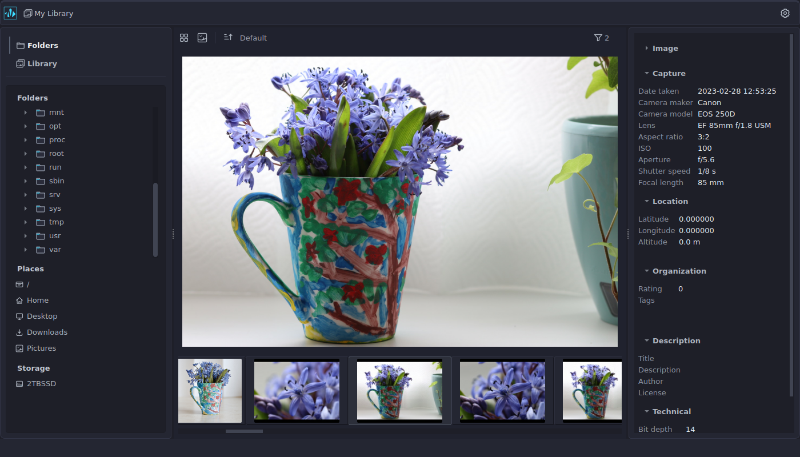

# Neofluxon

Neofluxon is a [Free Software](https://www.gnu.org/philosophy/free-sw.html) desktop application
for browsing, organizing, and managing photos through a non-destructive workflow, with support
for RAW and raster image formats, filesystem browsing, and multiple photo libraries.

The project is in early development, and features and functionality are still developed.

**Current release:** 0.1.0 (not released yet)

**License:** GNU General Public License, Version 3

**Website:** [https://neofluxon.com](https://neofluxon.com)



## Current features

- Non-destructive: Original files are never modified; all operations leave the source files and directories unchanged.
- Browse photos from the file system and libraries.
- Supported Image Formats:
  - RAW: Canon CR2 and CR3, Nikon NEF, Fujifilm RAF, and Adobe DNG.
  - Raster: JPEG (JPG/JPEG) and PNG.
- View thumbnails in a grid or filmstrip, with a large preview in filmstrip mode.
- Sort by name, date taken, or file size.
- Filter by RAW, JPEG, or PNG format.
- View image metadata in a left-side panel with collapsible sections.
- Browse file system sources in a right-side panel, supporting a folder tree, locations list, and storage list.
- Manage multiple photo libraries and switch between them within the same application instance.
- Create, rename, and delete libraries.
- Import folders into a library.
- Browse library contents using folder, date, and camera/lens tree views.
- Configurable directory scanning: option to scan single folder levels or traverse subdirectories recursively.
- Three-level image caching: display cache, memory cache, and disk cache.
- Multi-threaded background image decoding.


## Build from source

### Requirements

- CMake 3.31 or newer.
- A C++ compiler with C++26 support.
- Qt 6: Core, Gui, and Widgets
- Development libraries and dependences:
   - LibRaw,
   - libjpeg-turbo,
   - Exiv2,
   - Zlib,
   - libpng,
   - SQLite3
   - stb
   - pkg-config

## Build and Install 

Install the required development packages for the target platform, then configure and build:

```sh
cmake -S . -B build -DCMAKE_BUILD_TYPE=Release
cmake --build build --parallel
cmake --install build
```

## Planned features

The project is currently focused on building its Digital Asset Management (DAM) foundation.
 Planned features include photo culling, collections, searches,
 batch operations, duplicate detection, and file integrity checking.

## Technical overview

Neofluxon is written in C++ with Qt. Its core is implemented in C++,
 independent of any GUI framework, while the desktop interface is built with Qt.

## License

Neofluxon is free software, released under the GNU General Public License,
version 3 or (at your option) any later version. See [LICENSE](LICENSE).
